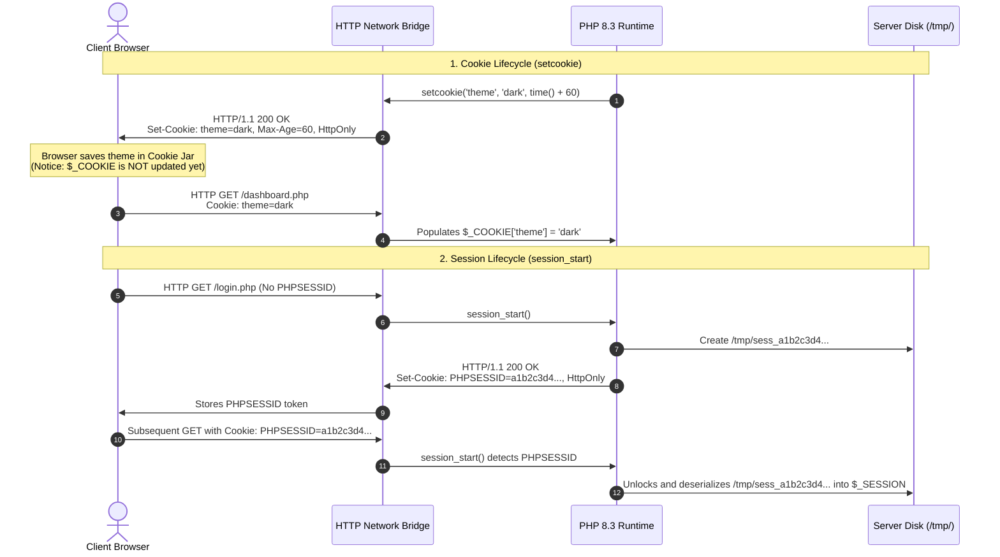

# 🐘 PHP Cookies & Sessions — Interactive Visual Lab

[](https://www.php.net/)
[](https://developer.mozilla.org/en-US/docs/Web/JavaScript)
[](LICENSE)
[](https://naviyagaming.github.io/php-cookies-sessions-lab/)
[]()

> An interactive visual educational laboratory and runnable PHP sandbox designed to demystify how **HTTP Cookies**, **PHP Sessions**, **Request/Response Headers**, and **Server-Side State** work under the hood.

---

## 🎯 Overview

HTTP is fundamentally a **stateless protocol**—every request is completely independent, and the server retains no memory of previous visits. Web applications bridge this gap using two primary techniques:

1. **Client-Side Cookies (`setcookie()`):** Small key-value strings stored inside the user's web browser, transmitted back and forth across every HTTP request header.
2. **Server-Side Sessions (`session_start()`):** Secure data files stored directly on the web server's disk (`/tmp/sess_<id>`), indexed by a single random client token (`PHPSESSID`) that acts as the locker key.

This project provides both an **interactive visual simulation** (accessible instantly in any browser without needing a web server) and a **native runnable companion script** (`index.php`) for hands-on local experimentation in XAMPP or PHP CLI.

---

## 🧠 System Architecture



---

## ✨ Key Features

### 1. 🧪 Interactive Visual Simulator (`index.html`)

A zero-dependency, single-page application built with **Tailwind CSS** and **Vanilla JavaScript** that models the full client-server lifecycle:

* **Three-Column Split Architecture:**
  * **Client Browser (Left):** Real-time Browser Cookie Jar, live TTL expiration countdown tickers, simulated webpage preview reflecting active cookies/sessions, and a `document.cookie` console inspector proving the protective power of the `HttpOnly` flag against Cross-Site Scripting (XSS).
  * **HTTP Network Bridge (Center):** Animated visual packet transmissions (`req` / `res`), formatted raw HTTP Request (`Cookie: ...`) and Response (`Set-Cookie: ...`) headers, and live synchronized PHP code traces with context explanations.
  * **PHP Server Engine (Right):** Live dumps of the `$_COOKIE` and `$_SESSION` superglobals in authentic PHP array format, plus an interactive server file explorer (`/tmp/sess_*`) displaying real serialized session strings (e.g. `username|s:9:"kasun_dev";`).

* **Interactive Cookie Controls:**
  * Define `$name`, `$value`, and `$ttl` (lifetime in seconds).
  * Toggle the `HttpOnly` flag to see whether JavaScript can read the cookie.
  * Immediate deletion via timestamp expiration (`time() - 3600`).
  * One-click presets for common cookies (`theme: dark`, `lang: en_US`).

* **Interactive Session Controls:**
  * Initialize sessions with `session_start()`.
  * Inject custom key-value pairs into `$_SESSION[$key] = $val`.
  * Clear in-memory variables with `session_unset()`.
  * Execute complete session destructions (`session_destroy()`) which wipe the server disk file and expire the `PHPSESSID` cookie.
  * Test `session_regenerate_id(true)` to see how new IDs prevent **Session Fixation attacks**.

* **Browser Lifecycle Actions:**
  * **Reload Page:** Dispatches an HTTP GET request with all currently held cookies, demonstrating why `$_COOKIE` updates only on subsequent requests.
  * **Close Browser:** Simulates closing the browser window—deleting transient session cookies (like `PHPSESSID`) while preserving persistent cookies with explicit expiry dates.

* **Guided One-Click Scenarios:**
  * 🔑 **Demo: User Login Session:** Automatically signs in an admin user, initializes the session file, and sets the secure session token.
  * 🎨 **Demo: Remember Theme Cookie:** Sets a persistent theme cookie and triggers an automated reload to demonstrate the full cycle.

---

### 2. ⚖️ Comparison Matrix & Interactive Quiz

* **Detailed Architectural Matrix:** Side-by-side comparison across 6 core criteria:
  1. Storage Location (Client Browser vs. Server Disk/Redis)
  2. Security & Tamper Resistance (Client-exposed vs. Server-isolated)
  3. Maximum Data Size (~4 KB vs. Virtually Unlimited)
  4. Supported Data Types (Strings only vs. Any serialized PHP type)
  5. Lifespan & Expiry (Timestamp-based vs. Browser close / GC timeout)
  6. PHP Functions & Superglobals (`setcookie` / `$_COOKIE` vs. `session_start` / `$_SESSION`)

* **Interactive Architecture Challenge:** 4 real-world scenario questions (Role permissions, UI theme persistence, multi-step checkout state, and "Remember Me" tokens) with immediate color-coded technical feedback and a live score counter.

---

### 3. 🐘 Runnable Local PHP Sandbox Script (`index.php`)

A self-contained, native PHP script ready to run directly in your local environment.

* **Features:**
  * Clean responsive dashboard that dynamically alters its theme based on `$_COOKIE['theme']`.
  * Forms to set, delete, and inspect cookies via native `setcookie()`.
  * Session controls to store data, call `session_unset()`, and destroy sessions.
  * Real-time dumps of PHP superglobals and output of the active `session_save_path()`.
  * Copy-paste ready directly from Tab 3 of the visual lab.

---

## 🚀 Quick Start Guide

### Option 1: Run the Interactive Visual Lab (No Server Required)

You do not need PHP, Apache, or Node.js installed to use the visual simulator:

1. Clone or download this repository:
   ```bash
   git clone https://github.com/NaviyaGaming/php-cookies-sessions-lab.git
   cd php-cookies-sessions-lab
   ```
2. Double-click `index.html` to open it in Google Chrome, Microsoft Edge, Firefox, or Safari.
3. Start experimenting with cookies and sessions immediately!

---

### Option 2: Run the Companion PHP Sandbox Script

To run the real PHP backend script:

#### Using the PHP Built-in Web Server (Recommended)
Make sure you have PHP installed (`php -v`):
```bash
cd php-cookies-sessions-lab
php -S localhost:8000
```
Open your browser and navigate to:
```text
http://localhost:8000/index.php
```

#### Using XAMPP / WampServer / MAMP
1. Copy `index.php` into your server root directory:
   * **XAMPP (Windows):** `C:\xampp\htdocs\php-lab\index.php`
   * **WampServer:** `C:\wamp64\www\php-lab\index.php`
   * **MAMP (macOS):** `/Applications/MAMP/htdocs/php-lab/index.php`
2. Start Apache from your control panel.
3. Open `http://localhost/php-lab/index.php`.

---

## 📂 Project Structure

```text
php-cookies-sessions-lab/
├── index.html        # Interactive visual simulation app (Tailwind CSS + JS)
├── index.php         # Standalone runnable PHP backend test sandbox
├── .gitignore        # Standard Git ignore file for temp & OS files
├── LICENSE           # MIT License
└── README.md         # Comprehensive documentation & architectural guide
```

---

## 🛡️ Key Security Best Practices

| Security Risk | Mitigation Strategy | How to Implement in PHP |
|---|---|---|
| **Cross-Site Scripting (XSS)** | Set `HttpOnly` flag so malicious JavaScript cannot steal tokens via `document.cookie`. | `setcookie("token", $val, $exp, "/", "", true, true);` |
| **Man-in-the-Middle (MitM)** | Enforce `Secure` flag so cookies are only transmitted over HTTPS connections. | Set the 6th argument of `setcookie()` to `true`. |
| **Cross-Site Request Forgery (CSRF)** | Enforce `SameSite` attribute (`Strict` or `Lax`) on cookies. | `setcookie("id", $val, ['samesite' => 'Strict', 'secure' => true]);` |
| **Session Fixation** | Invalidate the previous session ID upon login or privilege escalation. | `session_regenerate_id(true);` |
| **Sensitive Data Exposure** | Never store user passwords, database IDs, or admin privilege flags in cookies. | Keep sensitive authentication states inside `$_SESSION` on the server. |

---

## 🌐 Live Demo on GitHub Pages

The interactive visual simulator is hosted live and free on GitHub Pages:

👉 **[Launch Interactive Lab Demo](https://naviyagaming.github.io/php-cookies-sessions-lab/)**

*(No installation, servers, or setup required—opens directly in your browser!)*

---

## 🤝 Contributing

Contributions, questions, and feature suggestions are welcome!
1. Fork the Project
2. Create your Feature Branch (`git checkout -b feature/AmazingFeature`)
3. Commit your Changes (`git commit -m 'Add some AmazingFeature'`)
4. Push to the Branch (`git push origin feature/AmazingFeature`)
5. Open a Pull Request

---

## 📄 License

Distributed under the MIT License. See [`LICENSE`](LICENSE) for more information.

Developed with ❤️ for developers and students learning modern PHP state management.
